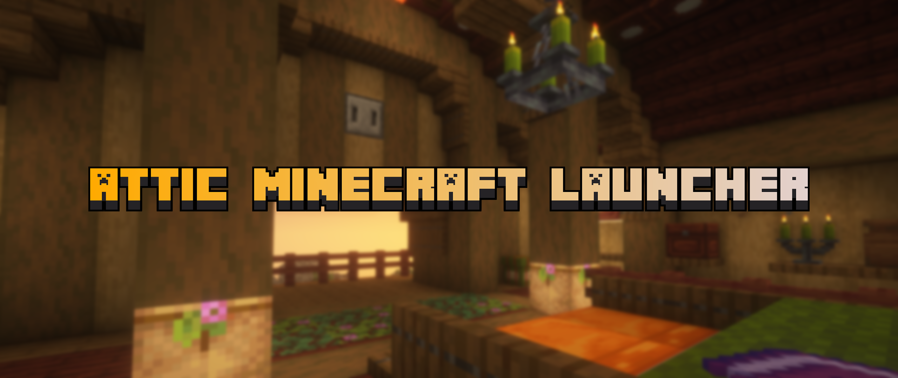

# Attic Minecraft Launcher - 远古 Minecraft 桌面启动器 (Legacy Minecraft Desktop Launcher)

`Attic Minecraft Launcher` 是一个**面向 Minecraft 早期历史版本（Pre-Classic、Classic、Indev、Infdev、Alpha、Beta 直至 b1.8 / 1.5.2）的轻量桌面启动器**——那些官方启动器不再提供、Betacraft Launcher v1 被其 UI 技术锁死、v2 重写中途停更的领域。

名字取自"阁楼"：家里放旧宝贝的地方，落满灰但都还活着。

<p align="center"></p>

> **免责声明**：本项目是独立开发的第三方开源启动器，并非 Minecraft 官方产品，未获 Microsoft、Mojang Studios 或任何第三方平台的赞助、认可或背书。
> *Independently developed third-party open-source launcher. Not an official Minecraft product; not approved or endorsed by Microsoft or Mojang Studios.*

它的核心理念是**薄执行器（Thin Client）**：版本数据与修复能力不写在客户端里——

```text
数据供给                        修复供给
Betacraft 版本 API              legacyfix javaagent
├── 版本清单 / 版本 JSON         ├── quirk 矩阵（游戏进程内解决）
├── 预 patch 客户端 jar          └── AMD 云 / 灰屏 / 鼠标 / classic-resize…
└── 皮肤与正版验证代理端点
            ↓                            ↓
      Attic 只做五件事：账户 · 版本解析 · Java 探测 · 参数拼装 · 进程生命周期
```

> **戒律**：任何"如果是 c0.0.15a 就……"的念头一律落成数据字段进版本表，不进客户端代码。这是 Betacraft v2 停更教训（功能对齐悬崖）的正面回答。

完整开发计划与架构见 [plan.md](./plan.md)，IPC 契约镜像见 [docs/contract.md](./docs/contract.md)。

---

## 🌟 核心功能特性

### 游戏侧能力（已可用）

- **远古版本全谱系**：Pre-Classic → 1.5.2 官方历史版本，版本清单、版本 JSON、预 patch 客户端 jar（sha1 校验）、资产索引、皮肤与 legacy 验证代理全部走 Betacraft 数据链路供给——客户端零版本数据，新增历史版本无需发版。
- **Java 运行时自动探测**：注册表 → 常见安装目录 → `JAVA_HOME` → `PATH` 收集候选，逐候选**实测执行**读取真实版本 / 架构 / `java.home`；优先 64 位 Java 8、无 64 位才回退 32 位，设置页可手动覆盖，并附全量探测报告（候选、拒绝原因、耗时）。
- **legacyfix 自动集成**：从 GitHub Release 自动更新落位；javaagent / coremod / mod 三种形态按版本区间过滤挂载（判定失败 fail-open + 诊断）；纯 Applet 容器版本自动剔除 classpath 中的 launchwrapper 并保持 deawt 开启。
- **BC 基础库集（depends 通道，v1 移植）**：`libs-<os>.zip`（**Betacraft patched** LWJGL/JInput jar——鼠标抓取等修复编进 jar 本体）+ `natives-<os>.zip` 由 `depends-version.txt` 版本号驱动整体刷新，与 `.info` libraries / Mojang 回填构成双通道库池；arm 宿主启动前过 LWJGL2 架构闸门（见 FAQ）。
- **Mods 仓库（一期 = Betacraft 单源）**：分类列表、按版本安装登记、启动期刷新与基座合成；对比 v1 做了结构性修复（原子写、sha1 必验、离线不误路由、陈旧合成重算）。
- **v1 语义实例系统**：`gameDir` 按实例（而非版本）派生，切版本存档不变；实例级 JVM 参数 / 窗口尺寸（默认 854×480）覆盖全局；首启自动创建 `default instance`。
- **启动管线可观测**：参数组序契约化拼装，干跑通道返回完整 LaunchConfig；独立控制台窗逐行日志 + 崩溃自动分类（out-of-memory / gl-init / lwjgl-native / unsatisfied-link / java-missing）；Applet 版本附 Windows 窗口看门狗，关窗即回收空转进程。
- **账户与数据**：离线账户（确定性 UUID，MC 离线格式）；设置与实例以 Java `.properties` 落盘；自定义版本 jar 导入与版本 JSON 编辑；数据根三平台解析 + portable 模式 + 可迁移老 `.betacraft`。

### 架构（三壳共享核心：Tauri 主发布 + Electron 可选形态 + Win7 兜底）

- **单一 IPC 契约**：`packages/core-spec` 是渲染 ↔ 宿主 **35 请求通道 + 4 事件通道**的唯一真相，契约测试与 CI 闸门拦截漂移。
- **三壳共享一个核心**：`apps/tauri`（主发布线、优先推荐：Rust 窗层 + Node sidecar 跑同一份 TS runtime，stdio NDJSON RPC）、`apps/electron`（日常开发壳 + 可选 Windows 发行形态，同进程直连，双壳并进）、`apps/electron-legacy`（Win7/8/8.1 兜底：Electron 22 复用 electron 主进程源码 + `net` 模块 fetch 桥）。启动核心只有一份 TS 实现，Rust 只做壳层与窗口；三形态数据根同轨，壳之间切换/共存零数据分叉。
- **跨语言契约闸门**：通道清单由 TS 导出 fixture，Rust 侧 `cargo test` 断言镜像常量与 host∪sidecar 分区不变量；宿主侧共享代码另受 **Node 16 API 锁**扫描（禁 `structuredClone` 等），保证兜底线可运行。
- **对壳透明的 UI**：同一份 Vue 3 前端探测 `window.attic` / `window.__TAURI__` 自动接线，浏览器直开降级 demo mock 桥；Modrinth App 组件形态迁移 + 全量语义化 CSS token；zh-CN / en 双语（缺键回落 en）。

### 分发（Phase 5 脚手架）

- **Windows Inno Setup 安装包**：三种发行形态共用一份 `installer/attic.iss`（flavor = main/electron/legacy 参数化，Inno 6.7.3 版本钉，简体中文 isl 已 vendor）；`[Code]` 层双闸 guard（主壳/Electron 壳 Win10+ / 兜底壳 Win7 SP1+、x64 载荷 IsWin64 防错装）；纯用户级安装（`PrivilegesRequired=lowest`，装 `%LOCALAPPDATA%\Programs`）；AppId 分轨可同机共存。2026-10-24 拍板 NSIS → Inno（NSIS 默认观感老旧 + builder 模板宏层崩溃史，崩溃戒律归档于 attic.iss 头注）。
- **自动更新**：Tauri updater minisign 签名密钥已生成、release CI 全平台矩阵就绪（Windows Inno x64/arm64 + Electron 壳 x64、macOS DMG arm64、Linux deb+AppImage x86_64、兜底 legacy x64/ia32）；updater 产物 = ISCC 输出 + CI `tauri signer sign` 手动签名，升级体验为可见 Inno 向导；兜底线按设计不随自动更新。Linux 首发 Debian 系（arch/redhat 按需），linux arm64 不分发（LWJGL2 无 arm64 原生库，见 FAQ）。

### 血统

本仓库是 [MCANextGen](https://github.com/CreatorCSIE/MCANextGen)（已归档）的直接后继，继承其 Java 探测、字节码能力探测与远古版本 JVM 参数知识，并采纳其反面结论——**永远不要把游戏窗口嵌进宿主**。

---

## 🧭 开发状态

| 阶段 | 内容 | 状态 |
|---|---|---|
| Phase 0–2 | 脚手架 / IPC 契约 / TS 运行时 | ✅ 完成 |
| Phase 3 | UI v0 + 设置页重写 + Mods/自定义版本 | ✅ 完成 |
| Phase 4 | Tauri 壳 + sidecar + Electron 22 兜底壳 | 🔨 联调收尾：真窗端到端已通（窗控/拖拽/图标/视觉收口、契约双绿），余 M2 桌面手动验收（真窗点 Play） |
| Phase 5 | Inno Setup 安装包分发 + release CI + updater | 🔨 全平台矩阵与签名密钥就绪，attic.iss 双 flavor 装退全绿 + 双壳并进第三 flavor（electron）编译绿；Secrets 登记、更新端点替换、CI 首跑真载荷收口待发布仓库定稿 |
| Phase 6 | Microsoft 账户登录、addons、MC 工具接入、Java 深搜（deepScan）、Discord RPC 等 | 📋 愿望池（不承诺时间）；addons 的 javaagent 分叉路线（fork vs 自写）评估中；工具接入两通路已定案（attach 类走 `-javaagent` 预挂载、种子类外置进程联动实例世界 seed）；Java 深搜方案已归档（配方与契约成本细则见 plan.md） |

---

## 💻 运行环境要求

### 1. Java 运行环境（游戏侧必需）

- **推荐：64 位 Java 8（JRE 或 JDK 均可）**，探测逻辑优先命中；**32 位 Java 8** 仅作无 64 位时的回退。
- 探测**不依赖 `PATH` 里第一个 `java` 是谁**：即使系统默认 `java` 已是新版，只要机器上装有 Java 8 就能被找到并选中；也可在设置页手动指定 Java 路径覆盖自动选择。

### 2. 开发环境（构建启动器本体）

- **Node.js ≥ 20（LTS）**
- **pnpm 10**（仓库声明 `packageManager: pnpm@10.34.5`，建议 `corepack enable` 后直接 `pnpm install`）
- **Rust 工具链**（仅开发 Tauri 壳需要，`rustup` 默认 stable 即可；Electron 线不依赖）
- 操作系统：Windows / macOS / Linux 均可开发（窗口看门狗等个别逻辑仅 Windows 生效；Inno 安装器构建与 WebView2 相关验证仅在 Windows）

---

## 🚀 如何编译与运行

### 1. 从源码构建（开发者）

```bash
# 克隆仓库
git clone https://github.com/CreatorCSIE/Attic-Minecraft-Launcher.git
cd Attic-Minecraft-Launcher

# 安装 workspace 依赖（apps/* + packages/*）
pnpm install

# 开发一条龙（默认 Electron 壳）：编译契约/runtime/主进程 → 起 vite(5310) → 拉起 Electron
pnpm dev

# 开发 Tauri 壳（需 Rust 工具链）：编译契约/runtime → 打 sidecar → tauri dev
# （vite 由 tauri 的 beforeDevCommand 自起 5310；等价于 pnpm --filter @attic/tauri dev，此为根目录快捷入口）
pnpm dev tauri

# 全仓库构建 / 类型检查 / 测试
pnpm build
pnpm typecheck
pnpm test

# 契约镜像闸门（TS → fixture 导出 / 漂移检查 / Node16 API 锁）
pnpm fixtures
pnpm fixtures:check
pnpm gate:node16

# Rust 侧契约镜像测试（单独跑，无需整壳启动）
cargo test --manifest-path apps/tauri/src-tauri/Cargo.toml
```

> **注意**：UI 改动经 vite HMR 即时生效；`runtime` / 主进程改动需重跑 `pnpm dev`（或 `pnpm dev tauri`）——dist 为一次性编译，避免半新半旧的产物不一致。`pnpm dev` 与 `pnpm dev tauri` 都占用 **5310** 端口（`--strictPort`），二者不可同时运行，切换前先停掉旧的 vite。

### 2. 仓库结构 (Repository Layout)

```text
Attic-Minecraft-Launcher
├── plan.md                 分阶段开发计划与风险登记
├── scripts/                dev.mjs 开发编排 / emit-contract-fixtures.mjs 契约 fixture / node16-api-gate.mjs API 锁
├── .github/workflows/      ci.yml（静态闸门 + Rust 契约测试）/ release.yml（全平台矩阵 + legacy）
├── docs/                   契约镜像（contract.md）、UI 设计守则（ui-design.md）、移植笔记
├── reference/              上游源码克隆（betacraft-launcher / legacyfix，gitignore，不入库）
├── apps/
│   ├── electron/           Electron 壳（开发 + 可选 Windows 发行形态 Electron 33：同进程直连 runtime）
│   ├── tauri/
│   │   ├── src-tauri/      Rust 窗层：ipc_forward 白名单转发 + 宿主面命令 + 契约镜像测试
│   │   └── sidecar/        Node sidecar：stdio NDJSON RPC 跑同一份 runtime（打包为 dist/server.cjs 随装）
│   └── electron-legacy/    Win7/8/8.1 兜底壳（Electron 22，esbuild 复用 electron 主进程源码 + net fetch 桥）
└── packages/
    ├── core-spec/          IPC 契约唯一真相：类型 + 通道 + 契约测试 + 跨语言 fixture
    ├── ui/                 共享 Vue 3 前端（双桥探测，对壳透明）
    └── runtime/            TS 启动器核心：数据根 / 下载 / 探测 / 拼装 / 进程
```

### 3. 数据目录

运行时数据落在 `%APPDATA%/.attic`（Windows）/ `~/.attic` 等（`assets/ bin/ launcher/ legacyfix/ versions/` 骨架自动创建；`launcher/instances/` 存实例档案）。仓库根放置 portable 标记时优先使用本地目录。

---

## 🌐 Localization / 国际化与多语言支持

界面内置 zh-CN / en 双语词典（缺键回落 en），欢迎社区补充更多语言的本地化。
*The UI ships with zh-CN / en locales (fallback to en); community translations are welcome.*

---

## ❓ 常见问题（FAQ）

### Q1：能启动哪些版本？支持 1.6 及以上吗？

覆盖 Pre-Classic 直到 1.5.2 的官方历史版本（含各期快照，以 Betacraft 版本清单实际提供为准）。1.6+ 不在本项目目标内——官方启动器已覆盖好那段历史，本启动器只做"官方不再提供"的部分。

### Q2：需要注册账号吗？没有 Microsoft 账户能玩吗？

能。离线账户即可启动游戏（按用户名确定性生成 MC 格式 UUID）；皮肤与 legacy 正版验证走 Betacraft 公共代理端点。Microsoft 账户登录在 Phase 6 计划中，当前未实现。

### Q3：游戏 jar 在仓库里吗？

不在，也不会分发。客户端 jar 与资产在首次启动时从 Betacraft 公共端点下载到本地数据目录，仓库不含任何 Mojang 版权内容（见许可证一节）。

### Q4：需要自己装 Java 吗？

游戏侧需要 Java 8（推荐 64 位），启动器不捆绑 JRE。会自动探测机器上已有的 Java（注册表 / 常见目录 / `JAVA_HOME` / `PATH` 逐个实测版本与架构），找不到或想指定别的，可在设置页手动选 Java 路径。

### Q5：老系统（Win7 / Win8）能装吗？

主发布线基于 Tauri + WebView2，要求 Windows 10 及以上（安装器会检测并指路）。Win10+ 用户若偏好自带 Chromium 的 Electron 壳（或对 WebView2 有障碍），可选装 Electron 安装包（`attic-launcher-electron-*`，与主壳同机共存、数据同轨），更新方式为检查+提示+手动下载。Win7 SP1 – 8.1 用户使用专门的兜底安装包（Electron 22 壳），功能对齐主线但**不提供自动更新**。

### Q5.5：M1/M2/M3 Mac 或 arm64 Linux 能跑吗？

分平台——**macOS Apple Silicon**：可以，提供 arm64 安装包（壳原生）；但游戏侧必须用 **x86_64 架构的 Java 8**（经 Rosetta 2 运行），Java 自动探测的架构偏好已优先命中 x64 JDK，若机器上只有 arm64 Java，启动器会在启动前给出明确指路（安装 x64 JDK / `softwareupdate --install-rosetta`）而不是让游戏裸崩。**Windows arm64**：提供 arm64 安装包，游戏进程经系统自带的 x64 模拟运行（装 x64 Java 8 即可）。**Linux arm64/arm**：不分发也不支持——LWJGL 2 官方从未发布 arm64/armhf 原生库，且无系统级 x64 模拟，启动器会明确拒绝并说明原因（Linux 走 x86_64 包）。社区 arm64 LWJGL2 重编译属 Phase 6 愿望池。

### Q6：存档和配置放在哪？能把整个启动器带走吗？

Windows 为 `%APPDATA%/.attic`，macOS / Linux 为 `~/.attic`（版本、资产、实例各占子目录）。在程序根目录放 portable 标记即优先使用本地目录；Betacraft Launcher v1 老用户可在设置页把数据根指回原 `.betacraft` 目录，存档与已下载版本直接复用。

### Q7：双击启动没窗口 / 秒退，怎么排查？

先看独立控制台窗的逐行日志——启动器会自动分类退出原因（内存不足 / GL 初始化 / LWJGL 原生库 / 链接失败 / Java 缺失），按对应提示处理即可。改内存、JVM 参数、窗口尺寸都在实例编辑页（点击实例卡片进入），实例参数覆盖全局设置。

### Q8：设置了窗口尺寸为什么没生效？

宽高设置仅对纯 Applet 容器版本（c 系列到 1.0.5 一代）生效；a1.0.4 起游戏主窗口自管分辨率与全屏，启动器不做干预——这也是本项目不把游戏窗口嵌进启动器的原因（见"戒律"与血统说明）。

### Q9：开发时 UI 显示"未检测到 IPC 桥"横幅？

浏览器直开 dev server（`http://localhost:5310/?demo=1`）属预期降级——demo mock 桥。走 `pnpm dev` 拉起 Electron 时若无桥，先重跑 `pnpm dev` 确认主进程产物与 UI 同为最新——`runtime` / 主进程改动是一次性编译，热更新只覆盖 UI 侧。

---

## 📄 许可证与版权声明 (License & Copyright)

- 本项目仅供 Minecraft 历史版本研究、怀旧与技术交流使用。
- 为了防止代码被恶意倒卖、闭源修改或注入恶意软件，本项目源码采用 **[GNU General Public License v3 (GPL v3) 许可证](LICENSE)** 进行强制开源。
  - **Copyright (c) 2026 CreatorCSIE. All rights reserved.**
- **第三方资产与商标免责声明**：
  - 本仓库**不包含、不分发任何官方 Minecraft 游戏 `.jar` 客户端包**；客户端 jar 与资产在首次启动时从 Betacraft 公共端点下载到本地数据目录。
  - `reference/` 下的上游参考源码（betacraft-launcher、legacyfix，同为 GPL-3.0）仅作本地研究用途，不随本仓库分发。
  - 本项目所涉及的 Minecraft 游戏资产、商标与品牌版权均归 **Mojang Studios / Microsoft** 所有。
